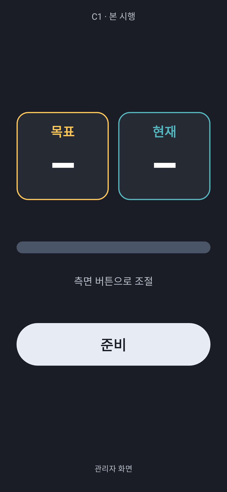
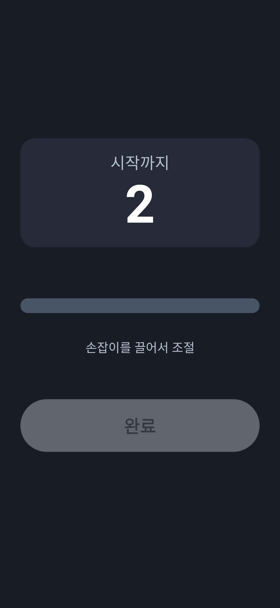
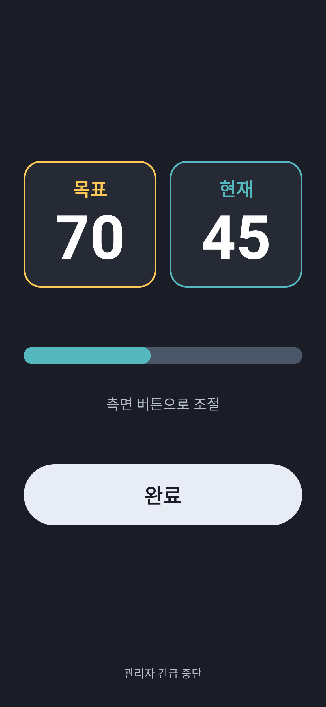
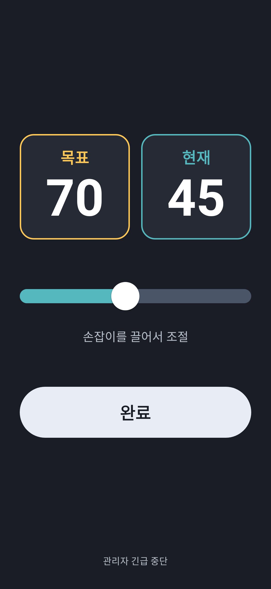

# Phase 1 · C1 물리 버튼 / C2 슬라이더 (팀원 1)

브랜치 `feature/phone-input` (기준: `feature/experiment-scaffold`) · 명세서 3장 T1, 4.2, 4.3, 10장, 17장

## 구현 파일
| 파일 | 내용 |
| --- | --- |
| `mobile/…/experiment/input/PhoneVolumeKeys.kt` | C1. `ExperimentInput` 구현. 볼륨 키 소비(시스템 음량 유지), 짧게 ±5, 길게 누르면 반복 ±5 |
| `mobile/…/experiment/input/PhoneVolumeSlider.kt` | C2. `ExperimentInput` 구현 + `Content()` 화면. 손잡이 드래그만 허용, 트랙 탭 차단 |
| `mobile/…/experiment/input/check/` | 검증 화면(`InputCheckActivity`), 오버슈팅·조작 횟수 계산(`TrialStats`), CSV 기록 |
| `mobile/src/test/…/experiment/input/` | 단위 테스트 18개 (입력, 오버슈팅, 조작 횟수) |

공통 모델(`shared/…/experiment/`)은 수정하지 않았습니다.

## 팀원 4(시행 화면)가 연결하는 방법
```kotlin
// C1: 시행이 ACTIVE가 되면
keys.start(attempt) { event -> controller.record(event) }
// Activity에서 키 전달 (ComponentActivity.dispatchKeyEvent는 AndroidX 내부 API라 Lint 에러)
override fun onKeyDown(k: Int, e: KeyEvent) = keys.onKeyEvent(e) || super.onKeyDown(k, e)
override fun onKeyUp(k: Int, e: KeyEvent) = keys.onKeyEvent(e) || super.onKeyUp(k, e)
// 종료 시
keys.stop()

// C2: 화면 중앙에 slider.Content(Modifier.fillMaxWidth()) 배치 후 같은 방식으로 start/stop
```
- 값이 실제로 바뀔 때만 `InputEvent`(이전값 → 현재값, `SystemClock.elapsedRealtime()`)를 냅니다.
- 누름/뗌, 0·100 경계에서 누름, 트랙 탭 차단 같은 원시 입력은 `rawListener`로 따로 받습니다.
  공통 `EventType`에 INPUT_DOWN/INPUT_UP을 추가할지는 팀 합의가 필요합니다 (명세 11.1).
- 길게 누르기 속도: `initialDelayMs`(기본 400), `intervalMs`(기본 150). 파일럿 후 확정.

## 검증 화면 실행
1. 실행 설정 `phone` → Edit Configurations → Launch: **Specified Activity**
   → `com.hci.teamp.experiment.input.check.InputCheckActivity` → ▶
   (또는 기기 앱 목록의 **C1·C2 입력 검증** 아이콘)
2. 탭(C1/C2) 선택 → `과제` 버튼으로 과제 선택 → **준비** → 3초 카운트다운 → 조작 → **완료**
   - 준비 전에는 입력을 받지 않습니다 (명세 5.2). 볼륨 키는 그래도 소비해서 시스템 음량은 그대로입니다.
3. 매 시도 후 항목별 **성공/실패** 기록, 끝나면 **CSV 내보내기** (Logcat 태그 `HCI_INPUT`)

결과 화면에는 시간, 최종값, 오차, **조작 횟수**, 칸 이동 수, **오버슈팅(최대 초과 거리 / 초과 진입 횟수)** 이 표시됩니다.
- 조작 횟수: 한 번 누르거나 잡은 뒤 뗄 때까지 값이 바뀌었으면 1회
  (C1 길게 눌러 여러 칸 = 1회, C2 한 번 끌어서 여러 칸 = 1회)
- 오버슈팅: 명세 10.3/10.4 정의. 증가 과제는 목표보다 높아진 만큼, 감소 과제는 낮아진 만큼
  예) 목표 70, 60→70→75→80→65→75 이면 최대 초과 10, 초과 진입 2회

| 검증 항목 (각 20회) | 확인할 것 |
| --- | --- |
| C1-짧게누르기 | 한 번 누를 때 정확히 ±5, 0/100에서 멈춤 |
| C1-길게누르기 | 계속 누르면 연속 ±5, 떼면 즉시 멈춤 |
| C1-시스템음량유지 | 패널의 "시스템 음량 … (변화 없음 ✓)" 유지, 시스템 볼륨 창이 뜨지 않음 |
| C2-드래그정확성 | 끄는 동안 5단위로 바로 갱신, 잡는 순간 값이 튀지 않음 |
| C2-트랙탭차단 | 손잡이 밖을 눌러도 값 그대로, 차단 횟수 증가 |

## CSV (Download/HCI_Experiment/, 내보낼 때마다 새 파일 2개)
**`phase1_phone_input_trials_날짜.csv`** — 시행 1회 = 1줄
| 열 | 뜻 |
| --- | --- |
| attempt_id, condition, task_id | 시도 ID(CHECK-C1-T04-A03), 조건, 과제 |
| start, target | 시작값, 목표값 |
| outcome | COMPLETED / TIMEOUT / INVALID |
| duration_ms | 카운트다운 끝(START)부터 종료까지 ms |
| first_input_ms | START부터 첫 누름/잡기까지 ms |
| final_value, abs_error, reached_target | 최종값, 목표와의 차이, 목표값에 한 번이라도 도달했는지 |
| max_overshoot, overshoot_count | 최대 초과 거리, 초과 영역 진입 횟수 |
| moves | 조작 횟수 (값을 바꾼 누름·드래그 수) |
| value_changes | 5단위 칸 이동 수 |
| touches_without_change | 값이 안 바뀐 누름·잡기 (경계에서 누름 등) |
| track_tap_blocked | C2 트랙 탭 차단 수 |
| wall_clock | 기록 시각 (Unix ms) |

**`phase1_phone_input_events_날짜.csv`** — 모든 이벤트 = 1줄
| 열 | 뜻 |
| --- | --- |
| seq | 순서 번호 |
| attempt_id | 시도 ID (시행 밖 이벤트는 빈칸) |
| kind | COUNTDOWN, START, DOWN, UP, VALUE_CHANGE, BOUNDARY, IGNORED, TRACK_TAP_BLOCKED, COMPLETED/TIMEOUT/INVALID, SYSTEM_VOLUME_CHECK, CHECK_RESULT 등 |
| elapsed_realtime_ms | 기기 단조 시계(ms). 같은 시도 안에서 빼면 경과 시간 |
| wall_clock | 기록 시각 (Unix ms) |
| previous, current | 값 변경 전/후 (VALUE_CHANGE) |
| source | C1_BUTTON / C2_SLIDER |
| detail | 원시 정보: 키 이름, 누른 시간, 짧게/길게, 자동 반복 수, 시스템 반복 수, 슬라이더 x좌표, 시스템 음량, 성공/실패 기록 등 |

trials의 오버슈팅·조작 횟수는 events만으로 다시 계산할 수 있습니다.

## 모임 전 정리 (팀원 1)

### 길게 누르기 설정값 (C1)
| 항목 | 현재 값 | 의미 | 바꾸는 곳 |
| --- | --- | --- | --- |
| 시작 지연 `initialDelayMs` | **400 ms** | 누른 뒤 이 시간이 지나면 연속 조절 시작. 이보다 짧게 누르면 1단계(±5)만 | `PhoneVolumeKeys.DEFAULT_INITIAL_DELAY_MS` |
| 반복 간격 `intervalMs` | **150 ms** | 연속 조절 중 ±5 간격 (초당 약 6.7단계, 0→100 약 3초) | `PhoneVolumeKeys.DEFAULT_INTERVAL_MS` |
| 단계 | 5 | 명세 4.1 고정 | — |
| 시스템 키 반복 | 사용 안 함 | 기기마다 반복 속도가 달라서 앱 자체 타이머로 통일. 시스템 반복 횟수는 원시 기록에만 남김 | — |

검증 화면(C1·C2 입력 검증)의 −/+ 버튼으로 바꿔 보며 비교할 수 있고, 실험 앱(실험 준비)은 위 기본값을 씁니다.
확정값은 파일럿 후 기본값 상수를 바꿔 고정합니다 (명세 19장).

### 모임에서 반복 검증할 항목 (S22 Ultra, 각 20회)
| 항목 | 방법 | 통과 기준 |
| --- | --- | --- |
| 짧게 누르기 | 볼륨 +/− 를 0.4초보다 짧게 | 누를 때마다 정확히 ±5 |
| 길게 누르기 | 볼륨 +/− 를 누른 채 유지 | 0.4초 뒤부터 0.15초마다 ±5, 0/100에서 멈춤 |
| 해제 | 길게 누르다 떼기 | 떼는 즉시 멈춤 (뗀 뒤 추가 변화 없음) |
| 시스템 음량 유지 | 위 조작 뒤 검증 패널 확인 | "변화 없음 ✓", 시스템 볼륨 창이 뜨지 않음 |
| 트랙 탭 차단 (C2) | 손잡이 밖 막대를 누르기 | 값 그대로, 차단 횟수 증가 |

### 알려진 제한사항
| 구분 | 내용 |
| --- | --- |
| 볼륨 키 | 앱이 화면 맨 앞에 있을 때만 가로챕니다. 화면이 꺼졌거나 알림창·잠금화면이 위에 있으면 시스템 음량이 바뀔 수 있습니다. 빅스비/측면 키 단축 설정이 있으면 꺼 두세요 |
| 볼륨 키 | 두 버튼을 동시에 누르면 먼저 누른 버튼만 인정하고 두 번째는 무시(원시 기록에 IGNORED) |
| 볼륨 키 | 화면 포커스를 잃으면(알림·전화) 길게 누르기 반복을 즉시 멈추고 '해제'로 기록 |
| 볼륨 키 | 접근성 기능(TalkBack 등)이 키를 먼저 가져가는 경우는 검증하지 않음 |
| 슬라이더 | 손잡이 터치 영역은 손잡이 중심에서 좌우 32dp(지름 64dp). 이 밖은 트랙 탭으로 차단 |
| 슬라이더 | 손가락을 빨리 움직이면 여러 칸을 한 번에 건너뛸 수 있으며, 실제 관찰된 값만 기록 (중간값을 만들지 않음, 명세 11.1) |
| 슬라이더 | 두 손가락 이상 동시 터치는 첫 손가락만 인정 |
| 기록 | 입력 이벤트는 시행 중 메모리에 있고 종료 시 저장 (팀원 3 수정 요청 진행 중, docs/persistent-experiment.md) |
| 오디오 | 시스템 미디어 음량이 0이면 소리가 안 남. 앱은 시스템 음량을 바꾸지 않으므로 관리자 화면 '음량 확인'에서 확인 |
| 오디오 | 가상 음량 → 재생 크기 곡선(선형/제곱/로그 40dB)은 폰에만 저장. 본 실험 전 하나로 확정하고 워치에도 같은 곡선 적용 필요 |
| 오디오 | 벨소리 음원·반복 간격은 아직 임시(`experiment_ringtone.wav`). 파일럿에서 비교 후 교체 |

## 시행 화면 (폰, 조건 공통)
C1·C2 모두 같은 틀: 가운데에 목표/현재 카드 → 음량 막대 → 완료 버튼. 막대는 길이·두께·색이 같고 C2에만 손잡이가 있습니다.
목표(노랑 테두리)와 현재(청록 테두리)는 색이 고정이며 목표에 도달해도 바뀌지 않습니다 (명세 5.1).

| 준비 | 카운트다운 | C1 시행 | C2 시행 |
| --- | --- | --- | --- |
|  |  |  |  |

준비·완료·다음 과제·연습 시작·본 실험 시작·다음 조건 버튼은 모두 같은 크기(높이 72dp, 화면 폭)와 같은 위치입니다.

## 확인 상태
- ✅ 빌드, Lint, 단위 테스트 통과 (CI 환경)
- ✅ 에뮬레이터 실행, 볼륨 키 소비 시 시스템 음량 유지 확인 (팀원 1)
- ⬜ 에뮬레이터에서 C1·C2 20회 검증
- ✅ Galaxy S22 Ultra에서 C1·C2 기본 작동 확인 (팀원 점검)
- ⬜ Galaxy S22 Ultra 실기기 20회 반복 검증 (모임에서 진행)
- ⬜ 새 시행 화면 배치·음량 확인 기능 실기기 확인


## 2026-11-21 통합본 보완

폰·워치 실험 조건의 일관성을 위해 게인 곡선 선택은 관리자 시험 재생에만 적용합니다. 실제 시행은 양쪽 모두 기존 선형 게인을 사용하며, 다른 곡선을 채택하려면 양쪽 구현과 명세를 함께 갱신해야 합니다. 조건 사이 휴식은 15초로 변경했습니다. 진동은 이번 촬영본에서 추가하지 않았습니다.
